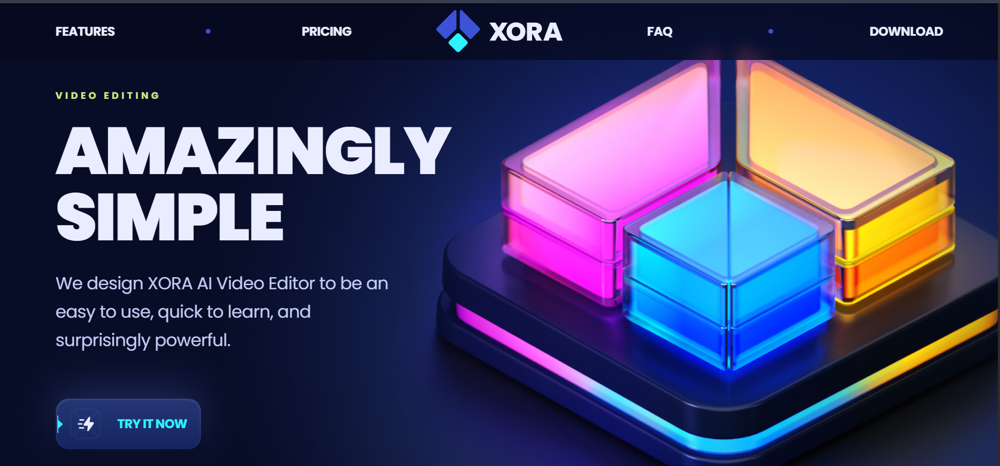

<div align="center">



<br/>
<br/>

# ✦ Xora — AI Video Editor SaaS Landing Page

**A stunning, production-ready SaaS landing page built with React 19, TypeScript, Tailwind CSS v4, and GSAP animations.**

<br/>

[](https://react.dev/)
[](https://www.typescriptlang.org/)
[](https://tailwindcss.com/)
[](https://gsap.com/)
[](https://vite.dev/)

</div>

---

## 📋 Table of Contents

- [✦ Overview](#-overview)
- [🌟 Features](#-features)
- [🗂️ Project Structure](#️-project-structure)
- [⚙️ Tech Stack](#️-tech-stack)
- [🚀 Getting Started](#-getting-started)
  - [Prerequisites](#prerequisites)
  - [Installation](#installation)
  - [Development](#development)
  - [Build & Preview](#build--preview)
- [🎨 Design System](#-design-system)
- [📐 Page Sections](#-page-sections)
- [💰 Pricing Plans](#-pricing-plans)
- [🧩 Components](#-components)
- [🎬 Animations](#-animations)
- [📦 Scripts](#-scripts)
- [🤝 Contributing](#-contributing)
- [📄 Footer](#-Footer)

---

## ✦ Overview

**Xora** is a fully-animated, pixel-perfect SaaS landing page for an AI-powered video editing platform. The project showcases modern front-end engineering with:

- ⚡ Blazing-fast builds powered by **Vite 8**
- 🎭 Scroll-driven and entrance **GSAP animations** (with `prefers-reduced-motion` support)
- 💅 Fully custom design system via **Tailwind CSS v4** CSS-first theming
- 📱 Responsive layouts that work beautifully across all screen sizes
- ♿ Accessible markup with ARIA attributes throughout
- 🧠 **React Compiler** integration for automatic memoisation and optimised re-renders

---

## 🌟 Features

| Feature                 | Details                                                                                    |
| ----------------------- | ------------------------------------------------------------------------------------------ |
| 🏠 **Hero Section**     | GSAP-animated entrance with floating hero image                                            |
| ⚡ **Features Section** | Scroll-triggered batch card reveals with detail icons                                      |
| 💲 **Pricing Section**  | Interactive monthly/annual toggle with animated CountUp prices and a glowing featured card |
| ❓ **FAQ Section**      | Two-column accordion layout with slide-in animations                                       |
| 💬 **Testimonials**     | Sticky heading + batched card reveals across two columns                                   |
| 📥 **Download Section** | Multi-platform download links (iOS, Android, Windows, Web) with partner logos              |
| 🧭 **Sticky Header**    | Transparent → frosted-glass on scroll with responsive hamburger menu                       |
| 🦶 **Footer**           | Social links (X, Threads, Instagram, Discord) with spring-pop animations                   |

---

## 🗂️ Project Structure

```
saas_landing_page/
├── public/
│   ├── images/
│   │   ├── hero.png              # Hero section image
│   │   ├── xora.svg              # Brand logo
│   │   ├── feature-1.png         # Feature card icons
│   │   ├── feature-2.png
│   │   ├── plan-1.png            # Pricing plan visuals
│   │   ├── plan-2.png
│   │   ├── plan-3.png
│   │   ├── screen.jpg            # App preview screenshot
│   │   ├── logos/                # Partner logos (Afterpay, Amplitude, Sonos…)
│   │   ├── testimonials/         # Reviewer avatar images
│   │   └── socials/              # Social media icons
│   └── favicon.ico
│
├── src/
│   ├── components/
│   │   ├── Button.tsx            # Reusable CTA button (anchor or button variant)
│   │   ├── FaqItem.tsx           # Accordion FAQ item with SlideDown animation
│   │   ├── Marker.tsx            # Decorative SVG marker for buttons
│   │   ├── NavLink.tsx           # react-scroll NavLink wrapper
│   │   ├── SlideDown.tsx         # Animated height-reveal component
│   │   ├── TestimonialItem.tsx   # Individual testimonial card
│   │   └── index.ts              # Barrel export
│   │
│   ├── sections/
│   │   ├── Header.tsx            # Sticky nav with blur effect + mobile drawer
│   │   ├── Hero.tsx              # Animated hero with floating image
│   │   ├── Features.tsx          # Feature + detail icon grid
│   │   ├── Pricing.tsx           # Pricing cards with CountUp toggle
│   │   ├── Faq.tsx               # Two-column FAQ accordion
│   │   ├── Testimonials.tsx      # Sticky-heading testimonials grid
│   │   ├── Download.tsx          # Cross-platform download + partner logos
│   │   ├── Footer.tsx            # Social links + legal text
│   │   └── index.ts              # Barrel export
│   │
│   ├── constants/
│   │   └── index.tsx             # All site data & SVG icon components
│   │
│   ├── App.tsx                   # Root component — section composition
│   ├── main.tsx                  # React DOM entry point
│   └── index.css                 # Tailwind v4 theme + all custom CSS
│
├── index.html                    # Vite HTML entry
├── vite.config.ts                # Vite + Tailwind + React Compiler setup
├── tsconfig.json                 # TypeScript project references
├── tsconfig.app.json             # App-level TS config
├── tsconfig.node.json            # Node/tooling TS config
├── eslint.config.js              # Flat ESLint config
├── .prettierrc                   # Prettier with Tailwind class sorting
└── package.json
```

---

## ⚙️ Tech Stack

| Category            | Technology             | Version |
| ------------------- | ---------------------- | ------- |
| **Framework**       | React                  | 19.3    |
| **Language**        | TypeScript             | ~6.0    |
| **Styling**         | Tailwind CSS           | v4.3    |
| **Animation**       | GSAP + @gsap/react     | 3.15    |
| **Build Tool**      | Vite                   | 8.3     |
| **Routing/Scroll**  | react-scroll           | 1.9     |
| **Counter**         | react-countup          | 6.5     |
| **Utilities**       | clsx                   | 2.1     |
| **Compiler**        | React Compiler (Babel) | 1.0     |
| **Package Manager** | pnpm                   | —       |

---

## 🚀 Getting Started

### Prerequisites

Ensure you have the following installed:

- **Node.js** `>= 18`
- **pnpm** `>= 8` _(recommended)_ — or npm / yarn

```bash
# Install pnpm globally if you don't have it
npm install -g pnpm
```

### Installation

```bash
# 1. Clone the repository
git clone https://github.com/your-username/saas_landing_page.git

# 2. Navigate into the project
cd saas_landing_page

# 3. Install dependencies
pnpm install
```

### Development

```bash
pnpm dev
```

The app will be available at **[http://localhost:5173](http://localhost:5173)** with Hot Module Replacement (HMR) enabled.

### Build & Preview

```bash
# Type-check + production build
pnpm build

# Preview the production build locally
pnpm preview
```

Output is emitted to the `dist/` directory, fully optimised and ready for static hosting (Netlify, Vercel, GitHub Pages, etc.).

---

## 🎨 Design System

The entire design system is defined in `src/index.css` using **Tailwind CSS v4's CSS-first `@theme` block** — no `tailwind.config.js` needed.

### Color Palette

| Token        | Hex       | Usage                                |
| ------------ | --------- | ------------------------------------ |
| `--color-p1` | `#2ef2ff` | Primary cyan — CTA highlights, icons |
| `--color-p2` | `#3c52d9` | Deep blue — accents                  |
| `--color-p3` | `#c8ea80` | Lime green — featured plan, badges   |
| `--color-p4` | `#eaedff` | Near-white — headings, body text     |
| `--color-p5` | `#c4cbf5` | Muted lavender — secondary text      |
| `--color-s1` | `#080d27` | Dark navy — page background          |
| `--color-s2` | `#0c1838` | Card background                      |
| `--color-s3` | `#334679` | Borders, dividers                    |
| `--color-s4` | `#1959ad` | Interactive borders                  |
| `--color-s5` | `#263466` | Subtle overlays                      |

### Typography

| Font        | Use                                   |
| ----------- | ------------------------------------- |
| **Poppins** | Headings, buttons — geometric, strong |
| **Inter**   | Body copy — readable, modern          |

### Shadows

| Token        | Effect                                 |
| ------------ | -------------------------------------- |
| `shadow-100` | Deep card shadows with inset blue glow |
| `shadow-200` | Elevated elements with cyan inset      |
| `shadow-500` | Multi-layer dark + indigo ambient      |

---

## 📐 Page Sections

### 🏠 Hero

The entry point of the page. Features an animated headline with skew entrance, body text fade, CTA button scale-in, and a large hero image that floats continuously using a `sine.inOut` yoyo tween.

### ⚡ Features

Two feature cards (Easy Integration · Secure & Trustworthy) with a bottom row of four detail icons:

- 🎬 AI Automated Video Editing
- 👥 Collaborate with your Team
- ☁️ Ultra Fast Cloud-Engine
- 🕐 24/7 Customer Support

### 💰 Pricing

Three flexible plans with an **animated billing toggle**:

| Plan                       | Monthly | Annual  |
| -------------------------- | ------- | ------- |
| Core _(Solo creators)_     | \$19/mo | \$12/mo |
| Overdrive _(Most popular)_ | \$79/mo | \$59/mo |
| Team _(For teams)_         | \$39/mo | \$29/mo |

Prices animate via `react-countup` on toggle. The featured **Overdrive** card emits a repeating cyan glow while in viewport.

### ❓ FAQ

Ten frequently asked questions split across two columns with GSAP slide-in from opposite directions on scroll.

### 💬 Testimonials

Six user testimonials from companies like Globalnomads, Cyberleap, and Floclips — arranged in a two-column staggered grid with a sticky left heading.

### 📥 Download

Multi-platform availability with icon links for **iOS**, **Android**, **Windows**, and **Web**, plus a macOS-style app preview window and logos of partner companies: Afterpay, Amplitude, Sonos, Maze, and Drips.

---

## 💰 Pricing Plans

> All plans include 24/7 support and access to 100+ AI prompt templates.

<details>
<summary><strong>Core — Best for solo creators</strong></summary>

- 100MB Cloud storage
- 100+ prompt templates
- 5 projects
- 24/7 support

</details>

<details>
<summary><strong>Overdrive — Most popular ⭐</strong></summary>

- All Core features
- 1TB additional storage
- Unlimited projects
- Analytics

</details>

<details>
<summary><strong>Team — Exclusively for teams</strong></summary>

- All Overdrive features
- 10TB additional storage
- 50% off per team member
- Real-time collaboration

</details>

---

## 🧩 Components

### `<Button />`

A polymorphic CTA button that renders as `<a>` or `<button>` depending on props. Features a gradient border, inner glow, `<Marker>` accent, and icon support.

```tsx
<Button icon="/images/zap.svg">Try it now</Button>
<Button href="/signup" icon="/images/circle.svg">Get Started</Button>
```

### `<NavLink />`

Wraps `react-scroll`'s `Link` component with active state management and mobile menu close handling.

### `<FaqItem />`

Accordion-style FAQ item using the `<SlideDown>` animation component for height transitions.

### `<TestimonialItem />`

Renders a user testimonial with avatar, name, role, and quoted comment.

### `<Marker />`

An SVG decorative bracket marker used in buttons and download links as a visual flourish.

### `<SlideDown />`

A height-animating wrapper using CSS `grid` rows from `0fr → 1fr` for smooth expand/collapse.

---

## 🎬 Animations

All animations are built with **GSAP 3** and follow production best practices:

| Practice               | Implementation                                                                                                        |
| ---------------------- | --------------------------------------------------------------------------------------------------------------------- |
| ♿ Reduced Motion      | `gsap.matchMedia()` with `prefers-reduced-motion` — durations set to `0` for users who prefer no motion               |
| 🧹 Cleanup             | All `matchMedia` instances call `.revert()` on component unmount via `useGSAP`                                        |
| 🎯 Scoped Selectors    | `useGSAP({ scope: ref })` prevents selector leaks between components                                                  |
| 🏎️ Batch Scroll        | `ScrollTrigger.batch()` used for all card groups — one `ScrollTrigger` per element, callbacks batched for performance |
| ⏱️ Timeline Defaults   | `gsap.timeline({ defaults: { ease, duration } })` avoids repeating per-tween config                                   |
| 📍 Position Parameters | `"-=0.4"` and `"<0.2"` overlap syntax instead of `delay` for tight choreography                                       |
| 👁️ autoAlpha           | Used over `opacity` to also manage `visibility`, preventing invisible elements from capturing pointer events          |
| 🔂 `once: true`        | Entrance-only `ScrollTrigger` instances self-kill after firing to free memory                                         |

---

## 📦 Scripts

| Command        | Description                                            |
| -------------- | ------------------------------------------------------ |
| `pnpm dev`     | Start the Vite dev server with HMR                     |
| `pnpm build`   | Type-check with `tsc` then produce a production bundle |
| `pnpm preview` | Locally serve the `dist/` production build             |
| `pnpm lint`    | Run ESLint across the entire project                   |

---

## 🤝 Contributing

Contributions, issues, and feature requests are welcome!

1. **Fork** the repository
2. Create a feature branch: `git checkout -b feat/amazing-feature`
3. Commit your changes: `git commit -m 'feat: add amazing feature'`
4. Push to the branch: `git push origin feat/amazing-feature`
5. Open a **Pull Request**

Please ensure all code passes `pnpm lint` and `pnpm build` before submitting.

---

## 📄 Footer

Create by MH Dev

<div align=center>
 Built with ❤️ using React, GSAP, and Tailwind CSS v4.
 <br />
 Thanks for JS Mastery.
</div>
